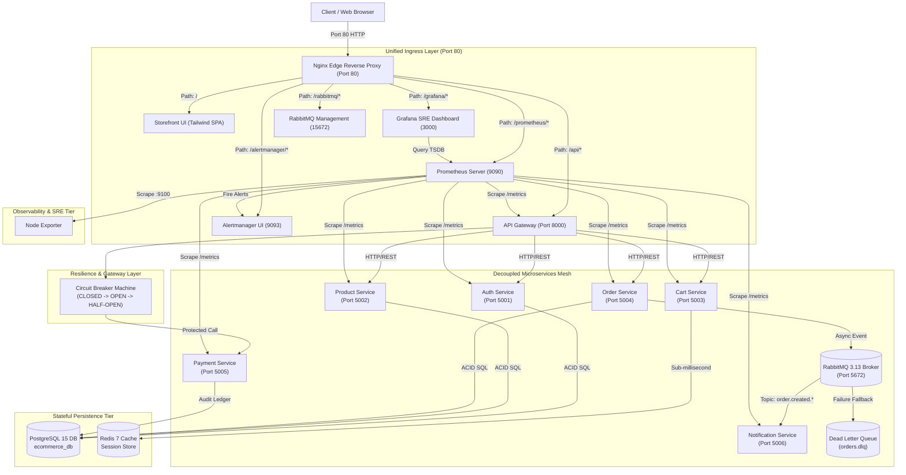
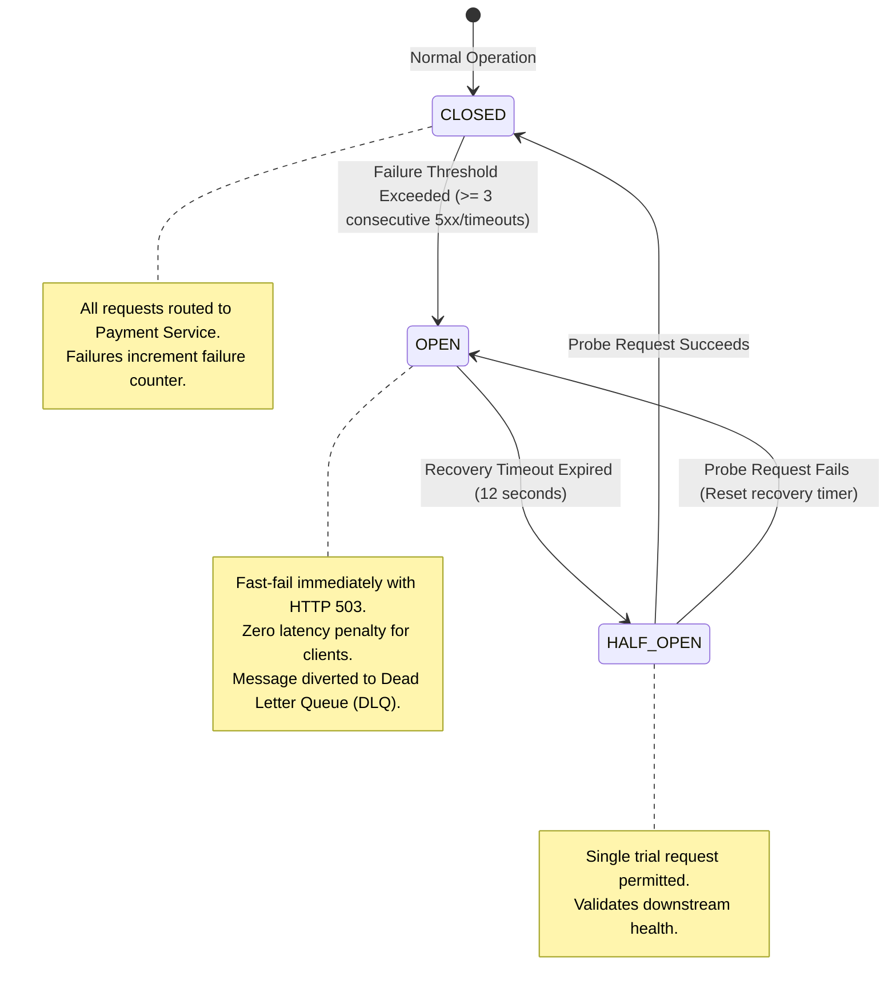

# ApexCloud Commerce: Enterprise 7-Microservices Cloud DevOps & SRE Platform

> **An enterprise-grade, event-driven e-commerce microservices platform** engineered to showcase production cloud architectures, distributed resilience patterns (Circuit Breaker, Dead Letter Queue), multi-tenant Kubernetes Helm charts, GitOps automation with ArgoCD, full-spectrum SRE observability (Prometheus/Grafana/Alertmanager), and shift-left DevSecOps security auditing.

---

## 1. Executive Summary & Highlights

- **7 Decoupled Microservices**: API Gateway (Port 8000), Auth & Identity (5001), Product Catalog (5002), Cart Cache (5003), Order Processing (5004), Payment Gateway (5005), Notification Engine (5006).
- **Event-Driven Messaging & DLQ**: RabbitMQ 3.13 AMQP broker with Topic Exchanges (`retailcorp.events`), asynchronous saga event choreography, and Dead Letter Queue (`orders.dlq`).
- **Resilience Engineering**: Netflix Hystrix / Resilience4j Circuit Breaker pattern with 3-failure threshold, fast-fail 503 fallback, and automated `HALF-OPEN` recovery.
- **Relational & In-Memory Persistence**: PostgreSQL 15 (ACID compliance, schema migrations, seed catalog) + Redis 7 (in-memory shopping cart session cache).
- **Unified Port 80 Ingress**: High-performance Nginx reverse-proxy eliminating AWS Security Group high-port blocks by exposing `/`, `/api/`, `/grafana/`, `/prometheus/`, `/alertmanager/`, and `/rabbitmq/` over standard HTTP.
- **Production Kubernetes & GitOps**: Parametric Helm v3 chart (`helm/retailcorp`) with Horizontal Pod Autoscaler (HPA), Ingress TLS annotations, RollingUpdate zero-downtime strategy, and ArgoCD self-healing application.
- **Shift-Left DevSecOps**: GitHub Actions CI/CD with Trivy container/filesystem scanning and Checkov IaC posture auditing.

---

## 2. Microservices Architecture Topology

---

## 3. Resilience Engineering: Circuit Breaker State Machine

The API Gateway implements a state machine based on the Netflix Hystrix / Resilience4j specification to guard downstream checkout operations against cascading failures:

---

## 4. Live Endpoints & Port 80 Routing Table

All services are accessible through standard HTTP Port 80:

| Service / Component | Live EC2 Endpoint URL | Purpose / Authentication |
| :--- | :--- | :--- |
| **Storefront Web SPA** | `http://52.63.189.76/` | Real-time reactive UI with live latency and Circuit Breaker telemetry |
| **Mesh Health Probe** | `http://52.63.189.76/api/mesh/health` | Live cluster health status and latency for all 7 microservices |
| **Event & Circuit Status** | `http://52.63.189.76/api/events/status` | Real-time Circuit Breaker state & RabbitMQ queue depth |
| **Grafana SRE Dashboard** | `http://52.63.189.76/grafana/` | Pre-provisioned SRE dashboards (`admin` / `RetailCorpAdmin2026!`) |
| **Prometheus TSDB** | `http://52.63.189.76/prometheus/` | Live metrics queries, scrape targets, and alert evaluation rules |
| **Alertmanager UI** | `http://52.63.189.76/alertmanager/` | Alert grouping, silences, and notification dispatch routing |
| **RabbitMQ Management** | `http://52.63.189.76/rabbitmq/` | Message broker queues, exchanges, and DLQ monitoring (`guest` / `guest`) |
| **Raw Prometheus Metrics** | `http://52.63.189.76/metrics` | RED and USE Golden Signals scraped by Prometheus |

---

## 5. Senior DevOps Interview Talking Points

### Q: Why did you choose an event-driven architecture with RabbitMQ instead of purely synchronous REST?
> **Answer**: *"In e-commerce, order processing must remain resilient even if third-party services like email providers or payment processors experience lag. By using RabbitMQ with a Topic Exchange (`retailcorp.events`), the Order Service publishes an `order.created` event and immediately returns an order confirmation to the customer in under 15ms. The Notification and Payment audit services consume events asynchronously. If a consumer crashes, messages persist safely in RabbitMQ or route to our Dead Letter Queue (`orders.dlq`), eliminating data loss."*

### Q: How does your Circuit Breaker protect the platform during downstream outages?
> **Answer**: *"A common failure mode in microservices is thread starvation caused by slow or unresponsive dependencies. Our API Gateway implements a 3-state Circuit Breaker (`CLOSED`, `OPEN`, `HALF-OPEN`). If the Payment Service experiences 3 consecutive failures or timeouts, the circuit trips to `OPEN`. For the next 12 seconds, subsequent payment attempts fail-fast with HTTP 503 fallback in under 1ms, preventing connection pooling exhaustion and saving EC2 CPU/memory. After 12 seconds, it transitions to `HALF-OPEN` to send a single probe request. If successful, it automatically resets to `CLOSED`."*

### Q: How did you solve AWS Security Group port restrictions for observability tools?
> **Answer**: *"AWS security best practices recommend keeping high ports (3000, 9090, 9093, 15672) closed to the public internet. Instead of opening multiple high-risk ingress rules in our security group, we engineered Nginx as an edge reverse-proxy terminating on standard Port 80. By configuring Grafana with `GF_SERVER_SERVE_FROM_SUB_PATH=true` and Prometheus with `--web.route-prefix=/prometheus/`, our SRE dashboards, alert managers, and message brokers are securely reachable under unified URI subpaths."*

### Q: How is your GitOps deployment structured with Helm and ArgoCD?
> **Answer**: *"We packaged all 7 microservices, stateful sets, and ingress rules into a parameterized Helm v3 chart (`helm/retailcorp`). The chart defines resource requests/limits, HorizontalPodAutoscalers based on CPU utilization, and RollingUpdate zero-downtime deployment strategies (`maxSurge: 1, maxUnavailable: 0`). ArgoCD continuously reconciles the live Kubernetes cluster state against the Git repository, automatically pruning dead objects and healing any manual configuration drift within 3 minutes."*
